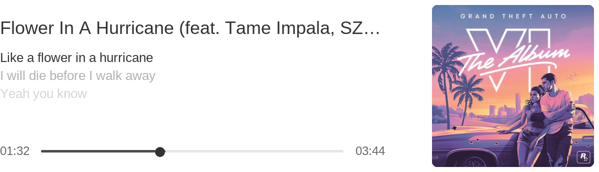

# GitHub profile widgets

A GitHub profile README that is actually alive: a QQ-Music-style **"now playing"
player** and a **Duolingo-style sticker board**, both rendered to static PNGs by
GitHub Actions. No JavaScript, no external services — everything works inside
GitHub's sanitized Markdown, in light and dark mode.

Rendered by this very repo (see it live on [the profile](https://github.com/d542Bb)):

| | |
| --- | --- |
|  |  |

## Quick start

1. Click **Use this template** and name the new repo `<your-username>/<your-username>`
   — a repository matching your username renders its README on your profile.
2. Trim: delete the folder of any widget you don't want (each is self-contained).
3. Personalise: edit each widget's `config.json`, replace its sample images,
   follow its README for the supported knobs.
4. Edit the root [`README.md`](../README.md) — that file is your profile, it is
   yours. The widgets only ever feed it images by file name.
5. Push. The **Build profile artwork** workflow regenerates the PNGs in
   `assets/` and commits them automatically.

## The widgets

| Widget | Generates | Docs |
| --- | --- | --- |
| [`player/`](player/) | `assets/player-{light,dark}.png`, `assets/control-bar-{light,dark}.png` | [player/README.md](player/README.md) |
| [`stickers/`](stickers/) | `assets/stickers.png` | [stickers/README.md](stickers/README.md) |

## How it is put together

- Every widget folder is self-contained: its `config.json`, `build.py`, static
  assets and docs live inside it.
- **Filenames in `assets/` are the contract.** The profile README only ever
  references generated images by name, so widget internals can be reorganised
  freely without touching the README. (Hand-placed personal images, like an
  easter egg, live in `assets/` too.)
- One workflow builds whatever `widgets/*/build.py` files exist — adding or
  removing a widget never touches YAML.
- Builds are deterministic: the same inputs produce byte-identical files, so
  the committing Action stays quiet until something actually changes.
- Everything renders at 2x and downsamples, for crisp text and clean outlines.

## Placing widgets in the README

The packed look comes from a two-column table: text and player stacked in the
left column, the sticker board spanning both rows on the right. Markdown does
not parse inside HTML table cells, so the text is written as HTML — it is only
a handful of tags (see the top of the root [`README.md`](../README.md) for a
working copy).

Sizing notes learned the hard way:

- GitHub's stylesheet adds ~13px of cell padding on each side and ~20px of
  image padding, so an `width="599"` player fits a 624px column exactly.
  With the player at its native 599px, the right cell leaves ~193px for the
  sticker board on the standard 846px profile column.
- Give the board cell `valign="top"` so the stickers start beside the text.
- A plain `align="right"` float also works and reflows better on phones, but
  short intro lines leave a hole between the text and the board — the table
  keeps everything packed on desktop (it scrolls horizontally on phones).
- Individual stickers inside the composed board can't carry links — if you
  need a clickable element, place a separate `<a href="..."></a>`.

## Adding your own widget

Create `widgets/<name>/build.py` that reads `widgets/<name>/config.json` and
writes PNGs into `assets/`. Nothing else to register — the workflow picks it
up on the next push.

## Build locally

```bash
pip install Pillow
python widgets/build_all.py
```

## Licensing

- The code is released under the [MIT license](../LICENSE).
- `player/fonts/` bundles Liberation Sans (SIL Open Font License 1.1).
- `player/qq-player-icons.png` was extracted from the QQ Music client for
  personal-profile use — replace it if you plan to redistribute the imagery.
- The sample images in `stickers/stickers/` are placeholders from various
  sources; replace them with your own.
